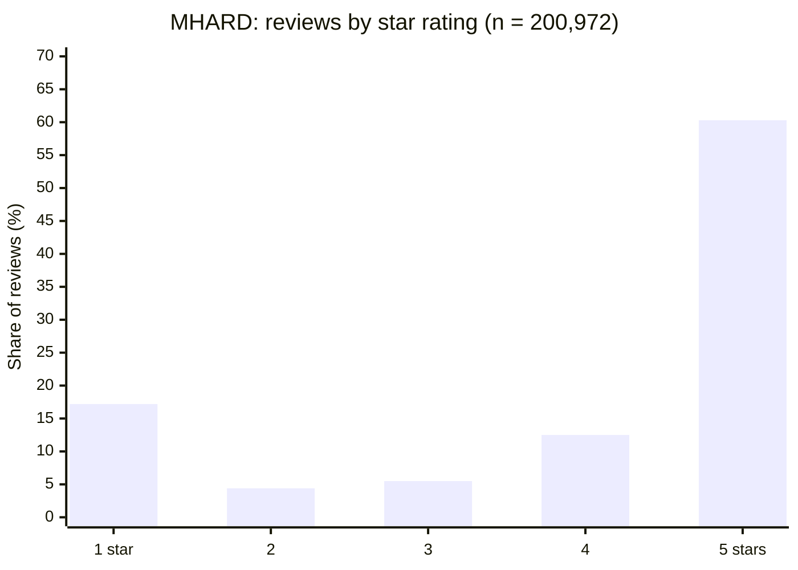
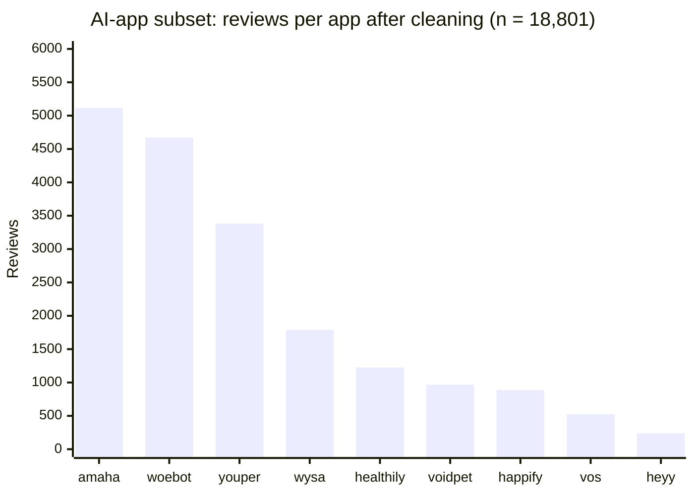
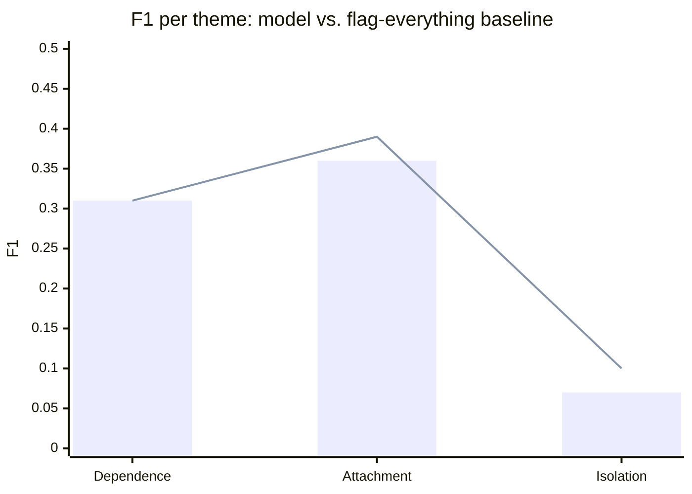

# AI Companion Risk Radar

**Classifying user-reported risk themes in AI mental-health app reviews with NLP**

Break Through Tech AI Studio, Fall 2026 · Host: Cornell Brooks School of Public Policy


> This is my copy of the team repository [Break-Through-Tech/Cornell-1B-ai-companion-risk-radar](https://github.com/Break-Through-Tech/Cornell-1B-ai-companion-risk-radar). The project is ongoing through December 2026.

---

## Table of Contents
1. [Project Overview](#-project-overview)
2. [Objectives and Goals](#-objectives-and-goals)
3. [Team and Individual Contributions](#-team-and-individual-contributions)
4. [Repository Structure](#-repository-structure)
5. [Setup and Installation](#-setup-and-installation)
6. [Methodology](#-methodology)
7. [Results and Key Findings](#-results-and-key-findings)
8. [Next Steps](#-next-steps)
9. [Documentation](#-documentation)
10. [License and Acknowledgements](#-license-and-acknowledgements)

---

## 🏗️ Project Overview

AI chatbots like Wysa, Woebot and Youper are used by millions of people for emotional support. Star ratings and safety policies don't show whether users are describing risky patterns, such as relying on the bot, bonding with it, or using it instead of people.

This project builds a text classifier that reads public Google Play reviews and flags four **risk themes**:

| Theme | What it means |
|---|---|
| **Dependence** | Reliance on the tool or difficulty reducing use |
| **Attachment** | An emotional bond or relationship with the tool |
| **Isolation / Displacement** | The tool replacing or being preferred over human support |
| **Crisis-Response Frustration** | Complaints about how the tool handles crisis or safety situations |
| **Other / None** | None of the above |

The intended users are product, trust and safety, and compliance teams. The project looks for patterns in reviews. It does **not** diagnose users, judge clinical effectiveness, or claim that an app caused any outcome.

## 🎯 Objectives and Goals

- Build a cleaned, documented subset of reviews for AI/chatbot mental-health apps
- Write a clear annotation codebook and hand-label a training sample
- Train an interpretable baseline classifier (TF-IDF + logistic regression)
- Evaluate with macro F1, per-class precision and recall, and confusion matrices
- Explain results in plain language for non-technical stakeholders
- Stretch goal: a dashboard of risk themes over time by app

## 👥 Team and Individual Contributions

| Name | GitHub | Contribution |
|---|---|---|
| **John Jahn** | [@jjahn-source](https://github.com/jjahn-source) | Wrote the risk-theme annotation codebook v1.0 ([CODEBOOK.md](CODEBOOK.md)): inclusion and exclusion rules for each theme, overlap rules, labeling decisions, and the round-1 re-check list. Reviewed and merged team PRs. |
| Coral Fragoso H | [@coralfragoso](https://github.com/coralfragoso) | TF-IDF + logistic regression baseline notebook, project coordination |
| David Adeleye | [@Floatz419](https://github.com/Floatz419) | Data exploration notebook, AI-app subset selection, data cleaning rules |
| Lynda Vasquez | [@lyndaregina](https://github.com/lyndaregina) | Dataset setup and Git LFS tracking |
| Tammy Ho | [@tammiecodes](https://github.com/tammiecodes) | Hand-labeled pilot sample of 100 reviews |

**My contribution in detail.** I turned the team's first 100 labeled reviews and their notes into a codebook that makes labeling repeatable. The key rule I set is that general praise ("this app helps me so much") is *not* a risk theme. Most reviews are positive, so without this rule labelers flagged nearly everything as Dependence or Attachment. The codebook gives every theme inclusion and exclusion lists with real review IDs as examples, a section on overlapping themes, a log of judgment calls with reasons, and a changelog so definitions can change without losing track of earlier labels.

## 📁 Repository Structure

```
ai-companion-risk-radar/
├── README.md                         # You are here
├── CODEBOOK.md                       # Annotation guidelines (v1.0)
├── Challenge-Project-Overview.md     # Original project brief
├── requirements.txt                  # Python dependencies
├── data/
│   ├── Dataset.md                    # Dataset sources and access
│   ├── MHARD_dataset_sample.csv      # Small sample of raw MHARD reviews
│   ├── ai_subset_clean_sample_100_labeled_merged.csv  # 100 hand-labeled reviews
│   ├── Data_Cleaning_Rules_Cornell_1B.pdf
│   └── data_exploration.ipynb        # Step 1: EDA and AI subset selection
├── notebooks/
│   └── baseline_tfidf_logreg_updated.ipynb   # Steps 2-4: features, model, evaluation
└── docs/
    ├── USER_GUIDE.md                 # How to label, run and read outputs
    └── API.md                        # Notebook parameters and functions
```

## 👩🏽‍💻 Setup and Installation

### Option A: Google Colab (recommended)

1. Open [`data/data_exploration.ipynb`](data/data_exploration.ipynb) or [`notebooks/baseline_tfidf_logreg_updated.ipynb`](notebooks/baseline_tfidf_logreg_updated.ipynb) on GitHub and click **Open in Colab**.
2. Upload the data to Google Drive at `MyDrive/dataset/` (see step 3 below), or set `DATA_PATH` to your own location.
3. Run all cells top to bottom.

### Option B: Run locally

**1. Clone the repo** (the CSVs are stored with Git LFS)
```bash
git lfs install
git clone https://github.com/jjahn-source/ai-companion-risk-radar.git
cd ai-companion-risk-radar
git lfs pull
```

**2. Create an environment and install dependencies**
```bash
python -m venv .venv
source .venv/bin/activate        # Windows: .venv\Scripts\activate
pip install -r requirements.txt
```

**3. Get the data**
- A labeled sample is included: `data/ai_subset_clean_sample_100_labeled_merged.csv`
- For the full dataset, download `MHARD_dataset.csv` (~76 MB, ~200k reviews) from [Sensify-Lab/MHARD](https://github.com/Sensify-Lab/MHARD) and place it in `data/`

**4. Explore the data and build the AI subset**
```bash
cd data
jupyter notebook data_exploration.ipynb
```

**5. Train and evaluate the model**
```bash
export DATA_PATH=data/ai_subset_clean_sample_100_labeled_merged.csv
export OUT_DIR=results
jupyter notebook notebooks/baseline_tfidf_logreg_updated.ipynb
```
The notebook trains one logistic regression per theme with repeated cross-validation and writes these files to `OUT_DIR`:

| File | Contents |
|---|---|
| `results_table.csv` | Per-class precision, recall, F1, AP, AUC |
| `confusion_counts.csv`, `confusion_matrices.png` | Confusion matrices per theme |
| `tfidf_settings_comparison.csv` | Cross-validated comparison of TF-IDF settings |
| `top_words.png` | Most influential words per theme |
| `oof_predictions.csv` | Out-of-fold predictions for error analysis |
| `baseline_logreg_models.joblib` | Trained models |

**6. Use a trained model on new reviews**
```python
import joblib
models = joblib.load("results/baseline_logreg_models.joblib")
reviews = ["I talk to this bot every night, I can't sleep without it"]
for theme, m in models["models"].items():
    p = m.predict_proba(reviews)[0, 1]
    print(theme, round(p, 3), p >= models["thresholds"][theme])
```
See [docs/API.md](docs/API.md) for the saved model format.

## 🧪 Methodology

### 1. Data exploration and subset selection
The full MHARD dataset has **200,972 reviews from 73 apps** (2011 to 2023). It has no duplicate IDs but 6,189 duplicate review texts, and 74% of reviews have no developer response. 60% of ratings are 5 stars.





We picked AI/chatbot-relevant apps by measuring how often each app's reviews mention *bot, chatbot, AI* or *robot*:
- **Tier 1, the app is a chatbot:** Wysa (35%), Youper (13%), Woebot (12%)
- **Tier 2, an AI chat feature inside a broader app:** Amaha, Happify, Healthily, VOS, Voidpet, Heyy

After removing empty and duplicate reviews, the AI subset has **18,801 reviews**.

### 2. Annotation
Risk themes are rare, so a random sample would be about 90% Other/None. We used keyword hits only to **oversample candidates** for labeling, never as labels, then hand-labeled 100 reviews using the [codebook](CODEBOOK.md). Reviews are multi-label.

### 3. Features and model
- **TF-IDF:** five settings compared by repeated 5-fold cross-validation (word 1-grams, word 1-2-grams, character n-grams, different minimum document frequencies). **Word 1-2-grams with min_df=3** scored best.
- **Model:** one logistic regression per theme with `class_weight="balanced"`. The regularization strength `C` and the decision threshold are tuned with an inner 3-fold CV on training data only, so test folds never leak into tuning.
- **Validation:** iterative (multi-label) stratified 5-fold CV, repeated 3 times.
- **Minimum data rule:** a theme needs at least 5 positive examples to be modeled. Crisis-Response Frustration had only 1, so it was skipped.

## 📈 Results and Key Findings

Cross-validated results on the 100-review pilot sample:

| Theme | Positives | Precision | Recall | F1 | "Flag everything" F1 |
|---|---|---|---|---|---|
| Dependence | 18 | 0.21 | 0.61 | 0.31 | 0.31 |
| Attachment | 24 | 0.24 | 0.69 | 0.36 | 0.39 |
| Isolation | 5 | 0.04 | 0.53 | 0.07 | 0.10 |
| **Macro F1 (themes)** | | | | **0.25** | 0.26 |


*Bars: model F1. Line: F1 from flagging every review.*

**Confusion counts** (averaged over 3 CV repeats, 100 reviews)

| Theme | True positive | False positive | False negative | True negative |
|---|---|---|---|---|
| Dependence | 11.0 | 41.3 | 7.0 | 40.7 |
| Attachment | 16.7 | 52.7 | 7.3 | 23.3 |
| Isolation | 2.7 | 68.7 | 2.3 | 26.3 |

**Words that push a review toward each theme** (top logistic regression weights)

| Dependence | Attachment | Isolation |
|---|---|---|
| helps me, my, this app, daily, stress | so, best, always, love, so much | real, therapy, therapist, you cant, already |

Full plots (confusion matrices, top-word charts, EDA histograms) are in the notebook outputs.

**What this means in plain language**
1. **The pipeline works end to end, but 100 labels are not enough.** The model catches most true cases (high recall) but also flags many reviews that aren't risky, so it does not yet beat the simple "flag everything" baseline.
2. **Key words are too rare to learn.** Words like *lonely, alone, addict, replace, crisis* and *suicidal* each appear in fewer than 3 of the 100 reviews, so TF-IDF drops them. The model falls back on generic words like *helps me* and *love*.
3. **This confirms the codebook's main rule.** The model's errors are mostly praise ("helps me so much") being confused with dependence or attachment. This is the same confusion the codebook was written to prevent for human labelers.
4. **Crisis-Response Frustration is very rare** in this sample (1 of 100) and needs targeted sampling.

## 🚀 Next Steps

- Label 400 to 500 more reviews, oversampling keyword candidates for rare themes, and measure inter-rater agreement (Cohen's kappa) between two labelers
- Lower `min_df` or add a keyword lexicon feature once there is more data, so rare risk words survive
- Compare against a second model (linear SVM or random forest), then a small transformer (e.g. DistilBERT) once the baseline is stable
- Run the classifier on all 18,801 AI-subset reviews and build the stretch-goal dashboard of themes over time by app
- Write a plain-language summary for Cornell Brooks stakeholders

## 📚 Documentation

- [docs/USER_GUIDE.md](docs/USER_GUIDE.md): step-by-step guide to labeling, running the notebooks, and reading the outputs
- [docs/API.md](docs/API.md): notebook settings, environment variables, functions and saved file formats
- [CODEBOOK.md](CODEBOOK.md): annotation guidelines
- [data/Dataset.md](data/Dataset.md): dataset sources

## 📝 License and Acknowledgements

Code is shared for educational purposes as part of Break Through Tech AI Studio. MHARD data is subject to the [Sensify-Lab/MHARD](https://github.com/Sensify-Lab/MHARD) terms.

Thank you to our Challenge Advisor **Ibrahim Emara** (Cornell Brooks School of Public Policy), our AI Studio Coach **Shaun Figueiro**, and the Break Through Tech AI team.

**References**
- Sensify Lab. *MHARD: Mental Health App Reviews Dataset.* https://github.com/Sensify-Lab/MHARD
- Aghakhani & Rezapour (2026). *AI-Mediated Mental Health Support on Reddit: Annotated Dataset of 5,126 Posts Across 47 Communities.* Zenodo. https://zenodo.org/records/18751157
